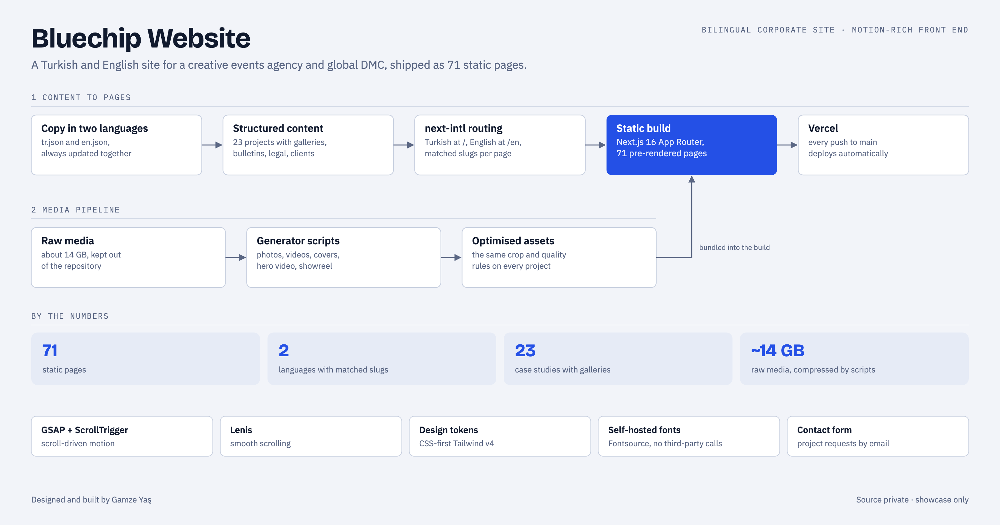
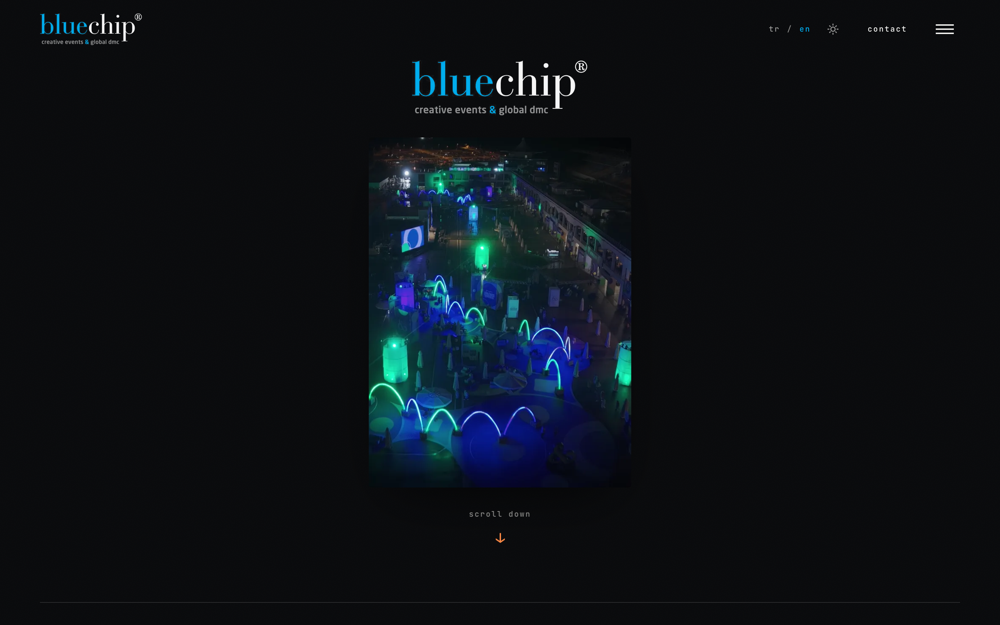
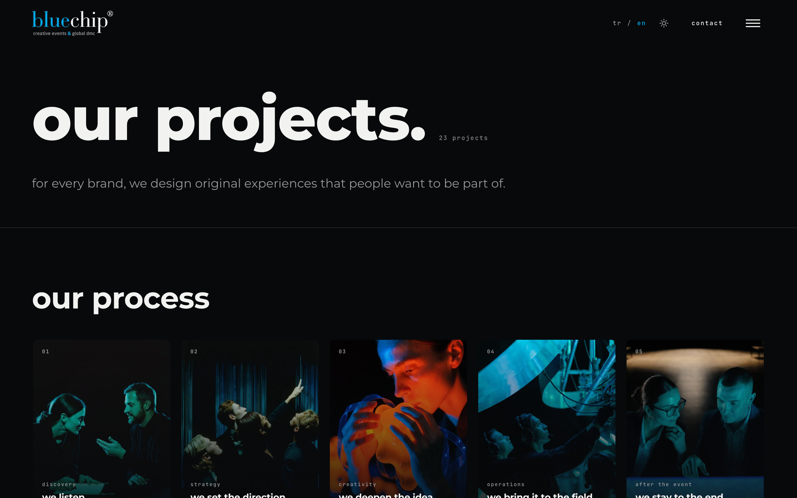
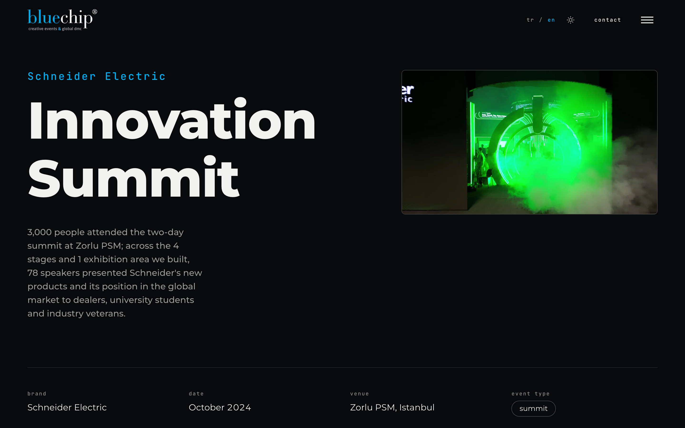
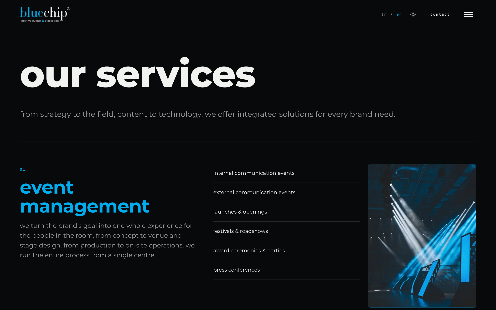

# Bluechip Website

**A bilingual (Turkish / English), motion-rich corporate site for a creative events agency and global DMC, shipped as 71 static pages.**

<picture>
  <source media="(prefers-color-scheme: dark)" srcset="docs/architecture-dark.png">
  
</picture>

> The source code is private (client work). This repository documents the architecture.

## Highlights

- **Two languages, one structure.** Turkish lives at the root and English under `/en`, with matched slugs per page (next-intl). Copy lives in `tr.json` and `en.json`, which are always updated together.
- **Structured content.** 23 case studies with galleries, a weekly bulletin archive, client and membership lists and legal texts, each in its own typed module.
- **A reproducible media pipeline.** About 14 GB of raw photos and video never enter the repository. Generator scripts produce gallery photos, videos, covers, the hero video and the showreel, with the same crop and quality rules for every project.
- **Motion with restraint.** GSAP with ScrollTrigger and Lenis smooth scrolling.
- **Design system.** CSS-first Tailwind v4 with design tokens, and self-hosted fonts with no third-party calls.
- **Working contact flow.** The project form doubles as a meeting request and sends email through Resend.
- **Static and fast.** Every page is pre-rendered, and every push to `main` deploys on Vercel.

## Screens

Live at [bluechip.com.tr](https://www.bluechip.com.tr).

| | |
|---|---|
|  |  |
|  | |

## Stack

Next.js 16 (App Router) · TypeScript · Tailwind CSS v4 · next-intl · GSAP + ScrollTrigger · Lenis · Fontsource · Resend · Vercel

## My role

Design implementation, information architecture, content modelling, media pipeline and deployment.
